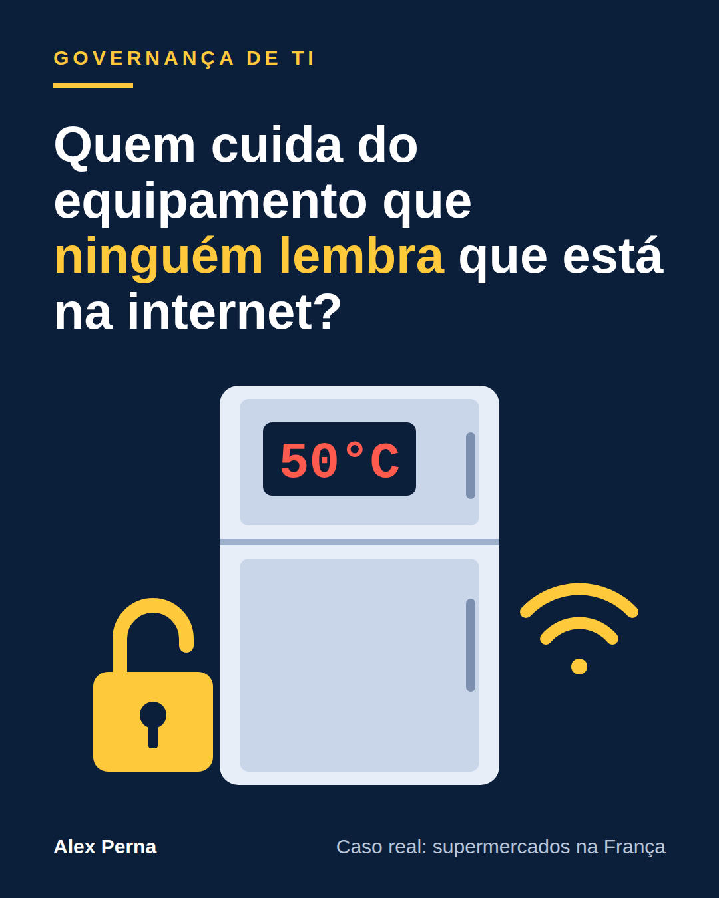

# Quem cuida do equipamento que ninguém lembra que está na internet?

Artigo publicado no LinkedIn em 19/10/2026 por Alex Perna: https://www.linkedin.com/pulse/quem-cuida-do-equipamento-que-ningu%C3%A9m-lembra-est%C3%A1-na-internet-perna-zimxf/

Na noite de domingo, 11 de outubro, alguém de fora assumiu o controle dos sistemas que comandam geladeiras e freezers de supermercados na França. O comando foi simples: acionar o ciclo de degelo, aquele que derrete o gelo acumulado, e deixá-lo rodando. A temperatura subiu até 50 °C. Em cerca de 150 lojas do grupo Les Mousquetaires (Intermarché e Netto), o calor durou seis horas, segundo a Reuters, e os produtos foram descartados.

Os números mudam conforme a fonte e o dia. A Reuters falou em pelo menos 350 supermercados; o grupo Mousquetaires, em 300 lojas só nas suas bandeiras; e, segundo a agência AP, o ministro das Finanças disse ao Parlamento, na terça (13), que cerca de 700 de 10 mil supermercados foram afetados. Carrefour, Monoprix, E.Leclerc e a Coopérative U (80 de 2.000 lojas) também foram atingidos. Um executivo do Mousquetaires estimou prejuízos de dezenas de milhões de euros em um único dia. Até terça, ninguém havia assumido a autoria e não houve pedido de resgate.

O ponto de virada veio da própria fabricante. A Danfoss, dona dos controladores atacados, disse que a maioria dos aparelhos era antiga e já sem atualizações: um modelo sem suporte desde maio de 2021 e outro descontinuado em 2016. Unidades mais novas também caíram, mas rodavam um firmware (o programa interno do equipamento) desatualizado. Os controladores eram administrados à distância, pela internet, por empresas de manutenção. E o problema não era segredo: em agosto, pesquisadores da Claroty tinham publicado um estudo sobre falhas nesse tipo de equipamento e contado milhares deles acessíveis online. Mesmo depois do ataque, a Reuters ainda encontrou pelo menos 4.500 painéis da Danfoss visíveis na internet. Como os invasores entraram? Nenhuma fonte oficial confirmou até agora.

## O que isso revela

Estudo gestão de TI, e este caso é um exemplo de manual de uma pergunta antiga: de quem é este ativo? Vou usar três referências que estudei.

Na ISO 27001 (norma internacional de gestão de segurança da informação), o Anexo A traz controles que se encaixam quase um a um: 5.9, inventário de informações e outros ativos; 5.19 e 5.22, segurança nas relações com fornecedores e monitoramento dos serviços deles; 8.8, gestão de vulnerabilidades técnicas; e 8.20, segurança de redes. No ITIL 4, as quatro dimensões da gestão de serviços incluem "informação e tecnologia", onde mora o inventário de ativos, e "parceiros e fornecedores", onde mora a dependência externa. No COBIT 2019, os objetivos BAI09 (gestão de ativos) e APO10 (gestão de fornecedores) tratam do mesmo tema.

Imagine uma rede fictícia de academias, a Vitalis. O sistema que controla climatização e catracas foi instalado há anos, o prestador acessa de casa e o contrato fala de manutenção, não de segurança. Ninguém na TI tem esse equipamento na lista, porque ele nunca foi "da TI". É o mesmo desenho do caso francês.

## A lição

Pelo que se sabe até aqui, o que falhou não foi a geladeira. Foi a gestão em três pontos.

Primeiro, **o ativo sem plano de saída**. A Danfoss avisou, em newsletter de outubro de 2025, que encerraria os serviços de produtos antigos. Segundo essa mesma newsletter, em 2022 já haviam sido alvo 16 supermercados na Rússia e 40 lojas em Israel, estas sem firewall ou VPN adequados. O aviso existia; faltou alguém do lado do cliente transformá-lo em decisão.

Segundo, **a exposição direta**. O órgão francês de resposta a incidentes, o CERT-FR, orientou desconectar os controladores ou filtrar o acesso e liberar o acesso remoto só por VPN, uma conexão protegida. Um especialista ouvido pela Reuters descreveu o caso como falta de higiene básica de segurança.

Terceiro, **o terceiro sem dono claro**. O mesmo alerta do CERT-FR recomenda checar as condições do seguro antes de cortar a internet do prestador de manutenção. Ou seja: na hora da crise, descobre-se que desligar o acesso também tem contrato, custo e consequência. Isso se resolve na calma, não durante o incidente.

## Três ações para esta semana

1. **Monte o inventário invisível.** Liste o que não é computador, mas tem acesso remoto: refrigeração, ar-condicionado, nobreaks, câmeras, controle de acesso, painéis de fornecedor. Para cada item, anote modelo, versão, se está fora de suporte, quem é o dono interno e quem acessa de fora.
2. **Procure o que está exposto.** Peça ao responsável pela rede para verificar quais equipamentos respondem a partir da internet. Feche o acesso direto e exija que fornecedores entrem por VPN, com segundo fator de autenticação e registro de acesso.
3. **Decida antes da crise.** Para cada equipamento fora de suporte, escreva um destino com responsável e data: trocar, isolar em rede separada ou aceitar o risco formalmente. Combine com fornecedor e seguradora o que acontece se for preciso cortar o acesso.

## Para conversar

Se alguém perguntasse hoje qual equipamento fora de suporte tem acesso remoto na sua empresa, a resposta estaria num inventário, ou só na cabeça de um prestador?

## Fontes

- [The Hacker News, 13/10/2026](https://thehackernews.com/2026/10/attackers-heat-french-supermarket.html): lojas por rede, modelos e status de suporte da Danfoss, orientações do CERT-FR, newsletter da Danfoss de outubro de 2025, ataques de 2022, estudo da Claroty.
- [ComplexDiscovery](https://complexdiscovery.com/refrigeration-hack-affected-about-700-french-supermarkets-government-says-as-danfoss-interfaces-stay-online/): resumo de Reuters, AP e BBC (6 horas a 50 °C, cerca de 700 lojas segundo o ministro, 4.500 painéis expostos, seguro e boletim CERTFR-2026-ALE-012).
- [OCCRP, 13/10/2026](https://www.occrp.org/en/news/hackers-turn-french-supermarket-refrigerators-into-furnaces): 300 lojas do Mousquetaires, investigação da Promotoria de Paris, sem autoria nem resgate.
- [Open Security Architecture, ISO 27001:2022](https://opensecurityarchitecture.org/frameworks/iso-27001-2022): números e nomes dos controles 5.9, 5.19, 5.22, 8.8 e 8.20.
- [Guia de estudo COBIT 2019](https://open-exam-prep.com/study-guides/cobit-2019/bai-dss-mea/bai-objectives): BAI09 e APO10.
- Nota de estudos: [ITIL 4: serviço, valor e 4 dimensões](https://github.com/alexpernaoficial/governanca-ti-estudos/blob/main/01-itil-gestao-de-servicos/05-itil-4-fundamentos-servico-valor-principios.md).

Nota sobre as fontes: os dados atribuídos ao CERT-FR, à Reuters, à AP e à BBC vêm das páginas acima, que os citam. Os números de lojas variam por fonte e aparecem com atribuição. A norma ISO 27001 é paga, então foram usados só os nomes dos controles.

#GovernançaDeTI #SegurançaDaInformação #ISO27001
