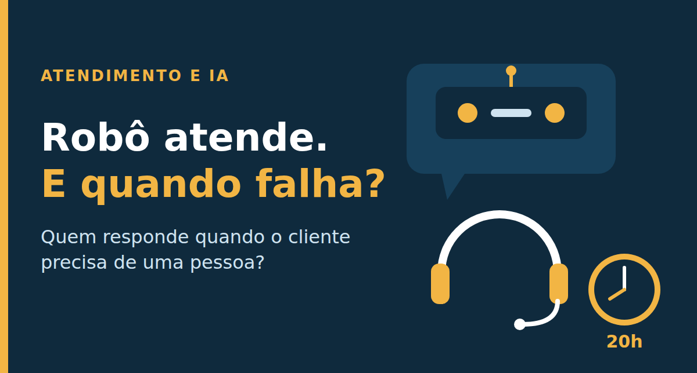

# Seu atendimento tem robô. Mas existe uma pessoa de verdade quando o cliente precisa?

Artigo publicado no LinkedIn em 23/10/2026 por Alex Perna: https://www.linkedin.com/pulse/seu-atendimento-tem-rob%C3%B4-mas-existe-uma-pessoa-de-verdade-alex-perna-bzidf/

Imagine a Marta, cliente de uma rede de academias (empresa fictícia, só para ilustrar). Domingo, 19h40, ela decide cancelar o plano. Abre o chat e o robô oferece um menu. Ela escolhe "cancelar" e recebe uma oferta de desconto. Escolhe de novo e cai em outro menu. Digita "falar com atendente" e lê: "Nosso horário de atendimento humano terminou. Volte amanhã."

Depois de seis telas, a Marta não chegou a lugar nenhum. No painel da empresa, porém, aquela conversa aparece como sucesso: o robô "resolveu" o contato sem gastar um atendente. Na segunda-feira, a reclamação já está nas redes sociais.

A cena é inventada, mas quem já tentou cancelar um serviço a reconhece. E na terça-feira, 13 de outubro de 2026, ela virou assunto de regra federal: o Diário Oficial da União publicou o Decreto 13.135/2026, o novo regime do SAC, o Serviço de Atendimento ao Consumidor.

## O que isso revela

Segundo as reportagens e análises que li (links nas fontes), o decreto entra em vigor em 2 de novembro de 2026 e vale para fornecedores regulados pelo Poder Executivo federal e para plataformas financeiras supervisionadas pelo Banco Central, não para todas as empresas. A regra central: atendimento por uma pessoa das 8h às 20h, todos os dias, por telefone e por pelo menos um canal eletrônico, que deve funcionar 24 horas. Inteligência artificial e automação continuam permitidas para triagem e resolução de demandas, mas não podem impedir o consumidor de falar com um atendente em tempo real.

Há também números de gestão: no telefone, em pelo menos 80% das demandas o contato com uma pessoa deve acontecer em até 20 segundos; os menus podem ter no máximo cinco níveis; e o cancelamento precisa estar disponível desde o primeiro nível.

Repare no formato da meta dos 20 segundos. Não é uma média, é o percentual de contatos que cumpre o prazo. A média engana: nove ligações atendidas em 2 segundos escondem uma que esperou cinco minutos. Esse é o tipo de indicador de nível de serviço (o compromisso de prazo com o cliente, conhecido como SLA) que uma boa gestão já deveria usar.

Aqui entra o que venho estudando em ITIL 4, um conjunto de boas práticas de gestão de serviços. Segundo a aula que assisti, do professor Wellington Mônaco, o ITIL define serviço como o meio de entregar o resultado que o cliente quer, e quem define o valor é quem consome, não quem entrega. Dos sete princípios orientadores, dois conversam direto com a cena da Marta: "foco no valor" e "otimize e automatize". O segundo traz um aviso que ficou comigo: automatizar só faz sentido depois que o processo está documentado, padronizado e medido. Automatizar um processo bagunçado apenas multiplica o erro.

## A lição

O robô da Marta não falhou na tecnologia. Falhou numa decisão de gestão: o indicador que ele perseguia (contato encerrado sem atendente) não era o que a cliente sentia (consegui cancelar?). Quando se mede só o que a automação consegue contar, o cliente que quer sair vira um número a ser desviado, e o valor, que no ITIL é definido por quem consome, some do painel.

O mercado também mostra que trocar pessoas por robôs é mais difícil do que parecia. Uma pesquisa da Gartner com 321 líderes de atendimento, feita em outubro de 2025, apontou que só 20% reduziram equipe por causa da IA, enquanto 55% mantiveram o quadro estável lidando com mais clientes. A mesma consultoria prevê que, até 2027, metade das organizações que esperavam grandes cortes por causa da IA abandonará esses planos, porque o atendimento sem pessoas se mostrou difícil de alcançar. É uma previsão, não um fato consumado, mas a leitura que faço é prática: IA entra bem como apoio e triagem, e a porta para uma pessoa precisa continuar aberta.

## Três ações para esta semana

1. **Teste a sua própria porta.** Faça como cliente: tente cancelar um serviço da sua empresa e falar com uma pessoa, uma vez em horário comercial e outra à noite. Conte as telas e o tempo até chegar a um humano. Se passar de cinco telas, você já achou o primeiro item do plano.
2. **Troque a média pelo percentual dentro da meta.** Em vez de "tempo médio de espera", acompanhe "percentual de contatos atendidos por uma pessoa em até X segundos" e olhe junto a taxa de resolução: o cliente resolveu o que queria? Quantas conversas o robô encerrou não diz isso.
3. **Padronize antes de automatizar.** Pegue a categoria com mais chamados e escreva o passo a passo. Defina o momento exato em que o robô passa a conversa para uma pessoa e quem é o dono desse fluxo. Depois, leia algumas conversas por semana e ajuste um procedimento de cada vez.

## Para conversar

Na sua operação, quanto tempo leva hoje para um cliente sair do robô e chegar a uma pessoa? E quem acompanha esse número?

## Fontes

- Ministério da Justiça (gov.br), [Novo decreto do SAC amplia proteção ao consumidor e estabelece regras de atendimento](https://www.gov.br/mj/pt-br/assuntos/noticias-1/novo-decreto-do-sac-amplia-protecao-ao-consumidor-e-estabelece-regras-de-atendimento)
- Brasil 61, [Novo SAC: consumidor terá direito a falar com uma pessoa das 8h às 20h todos os dias](https://brasil61.com/n/novo-sac-consumidor-tera-direito-a-falar-com-uma-pessoa-das-8h-as-20h-todos-os-dias-bras2617289)
- Forbes Brasil, 14/10/2026, [Decreto exige atendimento humano em SAC das 8h às 20h](https://forbes.com.br/carreira/2026/10/decreto-exige-atendimento-humano-em-sac-das-8h-as-20h/)
- Migalhas, [Novo decreto do SAC: automação admitida e atendimento humano](https://www.migalhas.com.br/depeso/466876/novo-decreto-do-sac-automacao-admitida-e-atendimento-humano)
- Gartner, 02/12/2025, [Pesquisa com 321 líderes de atendimento sobre redução de equipe com IA](https://www.gartner.com/en/newsroom/press-releases/2025-12-02-gartner-survey-finds-only-20-percent-of-customer-service-leaders-report-ai-driven-headcount-reduction)
- Gartner, 10/06/2025, [Previsão sobre abandono de cortes de equipe de atendimento por causa da IA](https://www.gartner.com/en/newsroom/press-releases/2025-06-10-gartner-predicts-50-percent-of-organizations-will-abandon-plans-to-reduce-customer-service-workforce-due-to-ai)
- TIexames, Wellington Mônaco, [ITIL 4 - Gestão de Serviços - Aula 1](https://youtu.be/Ddlws7iIfYc)

#GestaoDeTI #ITIL #AtendimentoAoCliente
