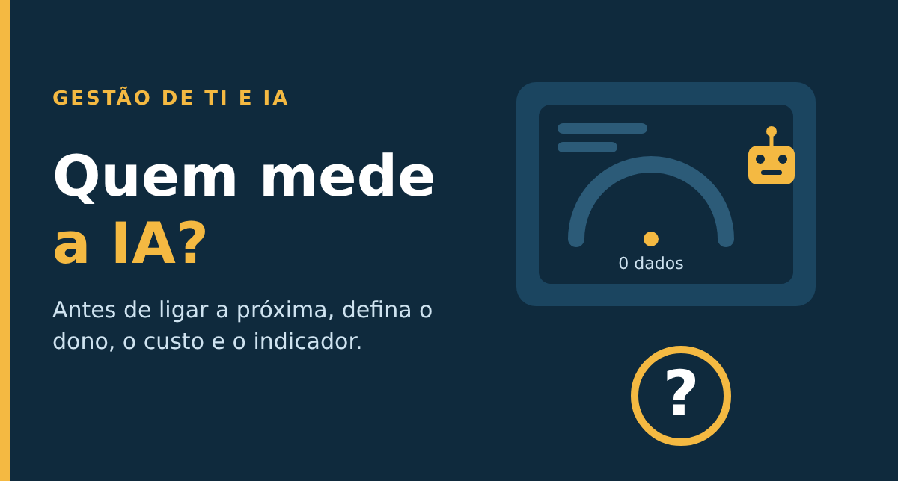

# Sua equipe usa IA. Mas quem mede o que ela entrega?

Artigo publicado no LinkedIn em 30/10/2026 por Alex Perna: https://www.linkedin.com/pulse/sua-equipe-usa-ia-mas-quem-mede-o-que-ela-entrega-alex-perna-shaff/

Imagine a cena. Uma rede de lojas de material de construção (exemplo fictício) usa IA em três áreas: o marketing gera textos, o financeiro resume contratos e o atendimento testa um assistente nas conversas com clientes. Na reunião de fim de mês, o diretor faz duas perguntas simples: quanto isso custa e o que a empresa ganhou com isso. Silêncio. Cada área tem uma impressão. Ninguém tem um número.

Parece exagero, mas é o retrato que saiu em outubro numa pesquisa da MIT Sloan Management Review Brasil, encomendada pela TOTVS, com 583 profissionais de empresas brasileiras. Segundo a cobertura da Forbes Brasil, a IA já está em cerca de 80% das empresas, mas só 7% a colocaram no centro do negócio. E 88% não medem o retorno financeiro dela. Um cuidado: a pesquisa foi encomendada por uma fornecedora de software, então vale como sinal, não como sentença.

## A tese da semana

Esta semana li notícias e estudei uma aula, e o fio que liga tudo é o mesmo: adotar IA é fácil, gerir é o trabalho.

Do outro lado do Atlântico, o Banco da Inglaterra e o regulador financeiro britânico (FCA) publicaram, em 26 de outubro, a pesquisa deles sobre IA no setor, com 196 respostas de instituições. O dado que mais me chamou a atenção: cerca de 80% já têm agentes de IA em produção, mas só 2% deixam esses agentes agirem com ampla autonomia. Na prática, o agente sugere e uma pessoa decide. O setor mais regulado do mundo está fazendo o que muita área de TI pula: dar autonomia só onde o impacto de errar é pequeno.

Esta semana estudei também o aulão de Visão Geral do Power BI, da Ka Solution, e o que me ficou foi menos a ferramenta e mais a lógica. Um indicador não nasce pronto: o dado precisa ser preparado e limpo antes (no Power BI, isso é o Power Query), o cálculo precisa ser definido de forma explícita (as chamadas medidas, escritas em uma linguagem chamada DAX, como o percentual de chamados resolvidos no prazo) e o acesso precisa ter regra: quem só vê e quem pode editar o relatório. Dito de outro jeito, indicador bom tem origem, definição e dono. É exatamente o que falta quando a pergunta do diretor fica sem resposta.

## A lição

O que falhou na cena do começo não foi a tecnologia. Faltou tratar a IA como um serviço: com dono, custo conhecido e um indicador de valor. É isso que as práticas de gestão de portfólio e de nível de serviço do ITIL pedem, e é o que o objetivo de governança de benefícios do COBIT (EDM02) resume: investir só vale se alguém consegue mostrar o benefício.

O mesmo vale para o lado de fora. Segundo a pesquisa britânica, 53% dos sistemas de IA de alta materialidade (os que mais pesam no negócio) já vêm de fornecedores, e aplicar gestão de risco de modelos a ferramentas de terceiros foi o desafio mais citado pelas instituições, por 54% delas. Aqui entra a gestão de fornecedores do ITIL e o processo de fornecedores do COBIT (APO10): antes de dar autonomia a uma ferramenta que você não construiu, classifique o impacto dela se errar.

Uma ressalva honesta: a pesquisa britânica mede o que as próprias empresas declaram, não é auditoria, e a brasileira foi encomendada por uma fornecedora. Os números são sinais, não provas. Mas o sinal aponta sempre para o mesmo lugar: a ferramenta correu na frente da gestão.

## Três ações para esta semana

1. Faça o inventário. Liste toda IA que sua equipe usa, inclusive as embutidas em ferramentas de fornecedor, e marque em cada uma quem é o dono, quanto custa e o que ela pode alterar sozinha.
2. Escolha um indicador antes de ligar a próxima IA. Pode ser tempo médio de resolução ou resolução no primeiro contato. Meça a base de hoje, para ter com o que comparar daqui a um mês.
3. Defina quem decide. Para cada uso de IA, escreva em uma linha se ela só sugere (e uma pessoa decide) ou se pode agir sozinha, e só libere autonomia onde o impacto de errar é baixo.

## Para conversar

Se o seu diretor perguntasse amanhã quanto a sua equipe gasta e quanto ganha com IA, você responderia com um número ou com uma impressão? Que indicador você usaria?

## Fontes

- Forbes Brasil: [IA chega a 80% das empresas brasileiras, mas só 7% usa no centro do negócio](https://forbes.com.br/forbes-tech/2026/10/ia-chega-a-80-das-empresas-brasileiras-mas-so-7-usa-no-centro-do-negocio/)
- Mix Vale, 15/10/2026: [Pesquisa do MIT Sloan e TOTVS revela que 88% das empresas não medem o retorno da IA](https://www.mixvale.com.br/2026/10/15/pesquisa-do-mit-sloan-e-totvs-revela-que-88-das-empresas-nao-medem-o-retorno-da-ia/)
- Bank of England e FCA, 26/10/2026: [Artificial intelligence in UK financial services 2026](https://www.bankofengland.co.uk/report/2026/artificial-intelligence-in-uk-financial-services-2026)
- Resultsense: [BoE/FCA AI survey 2026](https://www.resultsense.com/news/2026-10-27-boe-fca-ai-survey-2026-agents-third-parties/)
- Estudo: aulão Visão Geral do Power BI, Ka Solution (17/10/2026). Conteúdo e crédito da Ka Solution; resumo com minhas palavras.

#GestãoDeTI #InteligênciaArtificial #ITIL
