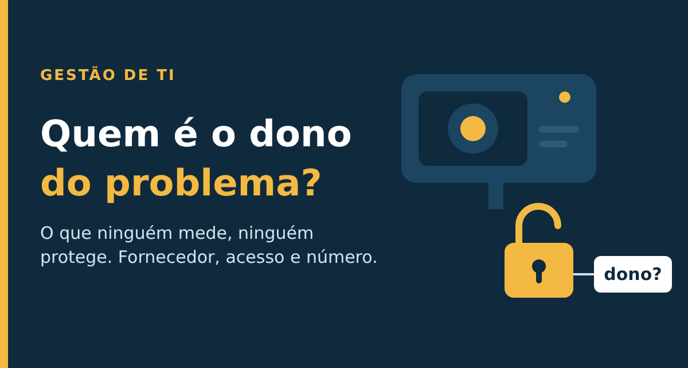

# Quem é o dono do problema? O que 17 mil câmeras abertas e uma aula de gestão têm em comum

Artigo publicado no LinkedIn em 09/11/2026 por Alex Perna: https://www.linkedin.com/pulse/quem-%C3%A9-o-dono-do-problema-que-17-mil-c%C3%A2meras-abertas-e-alex-perna-axm6f/

Na semana passada, uma reportagem do UOL apontou que links de transmissão de cerca de 17 mil câmeras de empresas parceiras do Smart Sampa, o programa de videomonitoramento da Prefeitura de São Paulo, estavam acessíveis na internet, sem senha. Quem tivesse o endereço certo veria imagens ao vivo de ruas e de entradas de estabelecimentos, sem precisar provar quem era. A Prefeitura nega que os dados estivessem públicos, classifica o caso como ato criminoso e abriu investigação.

O detalhe que mais pesa não é o número. É que, segundo a Agência Brasil, era a segunda falha em menos de um mês: a primeira envolveu de 50 mil a 58 mil câmeras, conforme o veículo, expostas por cerca de 11 meses. E as respostas seguiram um roteiro conhecido de quem trabalha com TI: a Prefeitura disse que a planilha nunca esteve pública, e o fornecedor de nuvem afirmou seguir boas práticas de segurança. Cada lado explicou onde a falha não estava.

Eu não sei de quem é a culpa, e este texto não é sobre isso. A pergunta que fica para quem lidera uma equipe é mais simples e mais incômoda: quem era o dono daquele acesso, e que número teria mostrado o problema antes da reportagem?

## A tese da semana

Esta semana juntei três peças: a reportagem acima; uma aula das Aulas de TI sobre o gestor de TI em 2026 (quem pede orçamento chega com número); e a ISO/IEC 27090, norma publicada em outubro de 2026 sobre ameaças a sistemas de IA, numa aula aberta da TIexames com o Prof. Rafael Batista.

O fio comum: o problema não foi falta de tecnologia. Foi falta de dono e de número.

Da 27090 levei o método: inventariar primeiro (inclusive usos não oficiais), controles que vêm da análise de risco de cada sistema, e governança para que o controle tenha dono e melhoria. É um guia, não uma certificação, e trata a cadeia de fornecedores como parte do risco.

## A lição

Terceirizar a operação não terceiriza a responsabilidade. No ITIL, a gestão de fornecedores existe para isso; no COBIT, o processo APO10 pede o mesmo; e a LGPD cobra de quem controla o dado, não de quem apenas o hospeda. Mas dono sem número não enxerga: conte, dê um custo, ache o desperdício, proponha a ação e meça de novo.

Exemplo fictício: uma equipe de suporte custa R$ 60 mil por mês e resolve 2.000 chamados, ou R$ 30 por chamado. Se 20% são repetições (400 chamados), são R$ 12 mil por mês. Troque "chamados repetidos" por "acessos de fornecedores": quantos fornecedores críticos temos, quantos têm dono com nome e quantos acessos foram revisados nos últimos 90 dias?

## Três ações para esta semana

1. Dê nome a cada fornecedor e acesso crítico, com uma pessoa responsável por linha.
2. Escolha um indicador simples e comece a medir (% de acessos de terceiros revisados em 90 dias, ou custo por chamado e % de repetições).
3. Escreva o plano para problema que começa do lado de fora: quem avisa quem, em quanto tempo, incluindo o prazo à ANPD (confira o prazo vigente).

## Fontes

- CNN Brasil, 03/11/2026: [Smart Sampa tem novo vazamento de imagens; prefeitura abrirá investigação](https://www.cnnbrasil.com.br/nacional/sudeste/sp/smart-sampa-tem-novo-vazamento-de-imagens-prefeitura-abrira-investigacao/)
- Agência Brasil, 03/11/2026: [Monitoramento por câmeras de São Paulo tem novo vazamento](https://agenciabrasil.ebc.com.br/radioagencia-nacional/seguranca/audio/2026-11/monitoramento-por-cameras-de-sao-paulo-tem-novo-vazamento)
- Canaltech, 03/11/2026: [Nova falha no Smart Sampa expõe 17 mil câmeras](https://canaltech.com.br/seguranca/nova-falha-no-smart-sampa-expoe-17-mil-cameras-e-imagens-de-autoridades-sem-senha/)
- Nemko: [ISO/IEC 27090 published as new AI cybersecurity standard](https://digital.nemko.com/news/isoiec-27090-published-as-new-ai-cybersecurity-standard)
- BSI: [Novo guia internacional para proteger a IA](https://www.bsigroup.com/en-GB/insights-and-media/media-centre/press-releases/2026/october/new-international-guidance-to-help-organizations-protect-ai-from-security-threats/)
- Aula aberta da TIexames com o Prof. Rafael Batista sobre a ISO/IEC 27090 (03/11/2026). Resumo com minhas palavras e créditos ao professor.

#GestãoDeTI #ITIL #Governança
